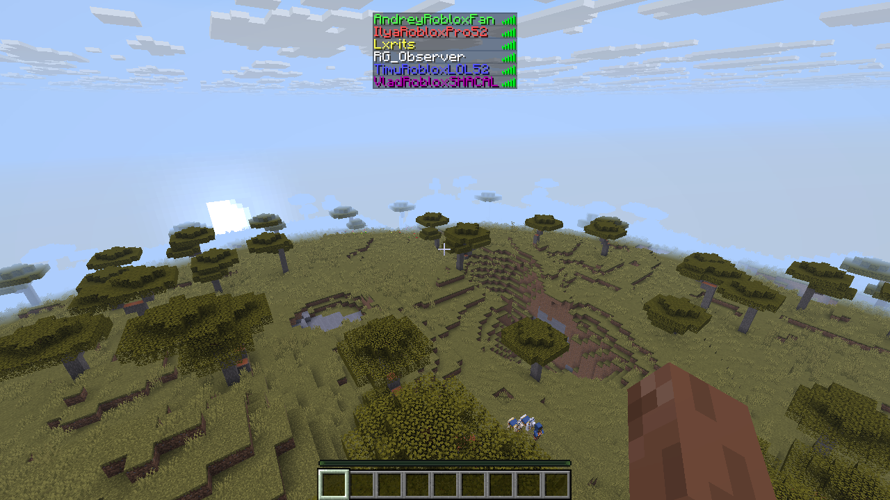
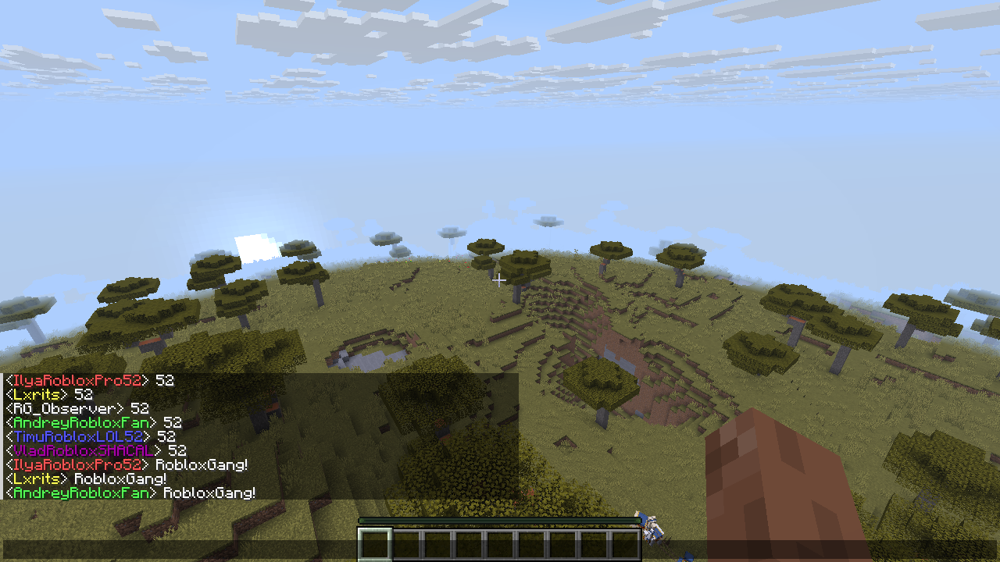
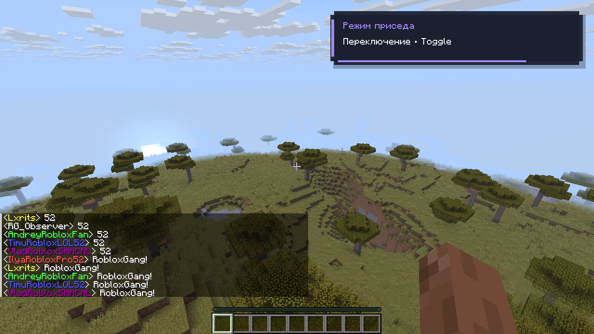
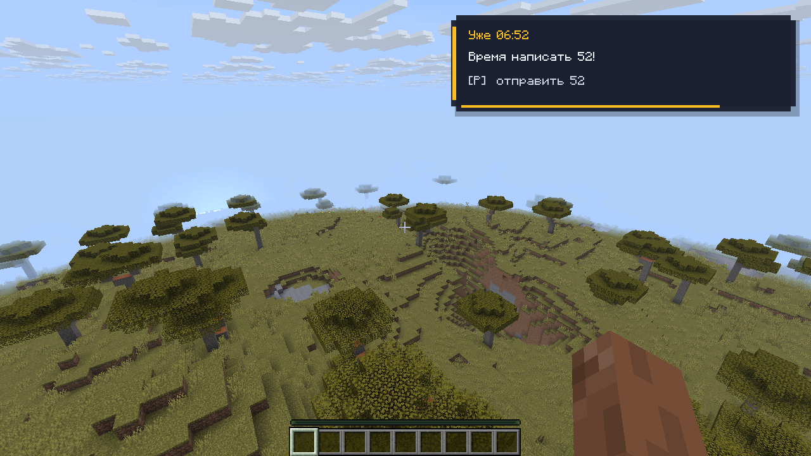

# RobloxGang Utilities


Клиентский мод для **Minecraft Java Edition / Fabric**: переключение режима приседа, напоминание о 52 и цвета участников RobloxGang. На сервер устанавливать не нужно.

**Версия: 1.0.2** · [Изменения](CHANGELOG.md) · [Описание релиза](releases/1.0.2.md) · [MIT](LICENSE)

## Что умеет

| Функция | Поведение |
|---|---|
| **G — режим приседа** | Переключает штатную настройку Hold / Toggle, сохраняет её и показывает анимированную карточку справа сверху. |
| **Напоминание о 52** | Каждый час в :52 местного времени показывает уведомление с перезвоном и текущей клавишей отправки. |
| **H — написать 52** | Отправляет одно сообщение `52` по нажатию в игровом мире. |
| **Цвета RobloxGang** | Окрашивает имена в табе, чате и неймтэгах. Определение по UUID, fallback по актуальному нику для offline-серверов. |
| **Настройки Mod Menu** | Включение функций, приоритет серверного/клиентского цвета, цвета участников, звук, масштаб, длительность и анимация уведомлений. |

По умолчанию **цвет сервера имеет приоритет**. В настройках можно выбрать клиентский приоритет: он заменяет цвет самого имени, сохраняя оформление префиксов, суффиксов и сообщения.

## Установка

1. Установите **Fabric Loader** для своей версии Minecraft.
2. Скачайте из раздела **Releases** этого репозитория **один JAR с точным номером Minecraft** и положите его в папку `mods` нужного экземпляра игры.
3. Установите [Fabric API](https://modrinth.com/mod/fabric-api) для той же версии игры.
4. Установите [Mod Menu](https://modrinth.com/mod/modmenu), чтобы открыть **Mods → RobloxGang Utilities → настройки**.

Mod Menu нужен для графических настроек; сами функции могут работать без него. Cloth Config и другие библиотеки интерфейса не требуются.

| Minecraft | Java | Проверенный Fabric Loader | Fabric API | Mod Menu |
|---|---|---|---|---|
| 1.21.10 | 21+ | 0.18.4 | 0.138.4+1.21.10 | 16.0.1 |
| 1.21.11 | 21+ | 0.18.4 | 0.141.6+1.21.11 | 17.0.1 |
| 26.1 / 26.1.1 / 26.1.2 | 25+ | 0.20.1 | 0.155.3+26.1.2 | 18.0.2 |
| 26.2 | 25+ | 0.20.1 | 0.161.0+26.2 | 20.0.3 |
| 26.3 | 25+ | 0.20.1 | 0.166.0+26.3 | 21.0.0 |

Переназначение: **Настройки → Управление → Назначение клавиш → RobloxGang Utilities**. При обновлении прежние назначения сохраняются; чтобы применить новые G/H, сбросьте нужные действия в управлении Minecraft. На русской раскладке эти физические клавиши могут отображаться как П/Р.

Поддерживаются перечисленные стабильные версии. Совместимость с будущими выпусками проверяется отдельно.

## Скриншоты из игры

Настоящие кадры 1280×720 с локального vanilla-сервера 1.21.10. На нём подключались пять автоматизированных тестовых профилей с именами участников; реальные владельцы аккаунтов в съёмке не участвовали. Имена, чат и уведомления не дорисовывались. Напоминание вызвано штатным предпросмотром.

**Таб — все пять ников одновременно:**



<details>
<summary>Чат, переключение приседа и напоминание</summary>







</details>

Эти кадры встроены в меню настроек и доступны без интернета. Превью таба увеличивает область с никами, сохраняя все пять имён целиком; в галерее есть отдельный просмотр чата.

## Ники, кэш и совместимость

Актуальные ники запрашиваются по пяти UUID у официального Mojang API и кэшируются на 24 часа. При недоступности API используется кэш, а до первого успешного запроса — исходные имена. Запросы к Mojang API не содержат переписку или адрес игрового сервера. Подробности и список участников — в [описании функций](docs/FEATURES.md).

Штатный чат обрабатывается без изменения подписанного текста сообщения. Нестандартные форматы чата и неймтэги серверных плагинов могут требовать дополнительной адаптации.

## Сборка и участие

Нужны **JDK 25** и **PowerShell 7**. Gradle Wrapper включён; скрипты работают на Windows и Linux.

```powershell
./build-all.ps1
# Только одна версия:
./build-all.ps1 -MinecraftVersion 1.21.10
```

Результат: `dist/1.0.2/`, семь JAR и `SHA256SUMS.txt`. Версия мода берётся из `gradle.properties`, зависимости — из `versions.json`.

- [Разработка и PR](CONTRIBUTING.md)
- [Публикация на GitHub](PUBLISH.md)
- [Проверки сборки 1.0.2 и их границы](VERIFICATION.md)
- [Подготовка локального сервера для снимков](tools/demo/README.md)

CI проверяет сборку, unit-тесты и содержимое JAR. Игровые прогоны выполняются отдельно. Файл `verification.json` содержит контрольные суммы исходных локально проверенных JAR; новая CI-сборка формирует собственные суммы.
